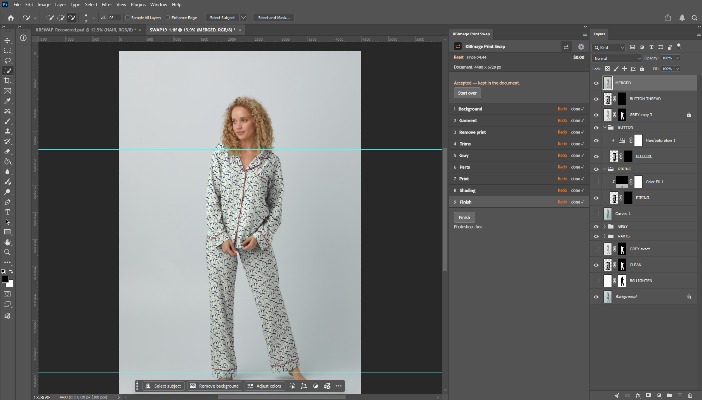
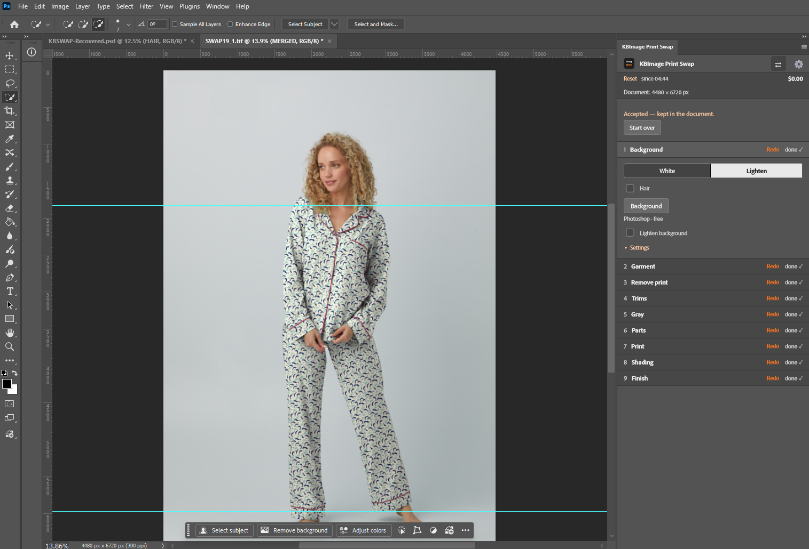
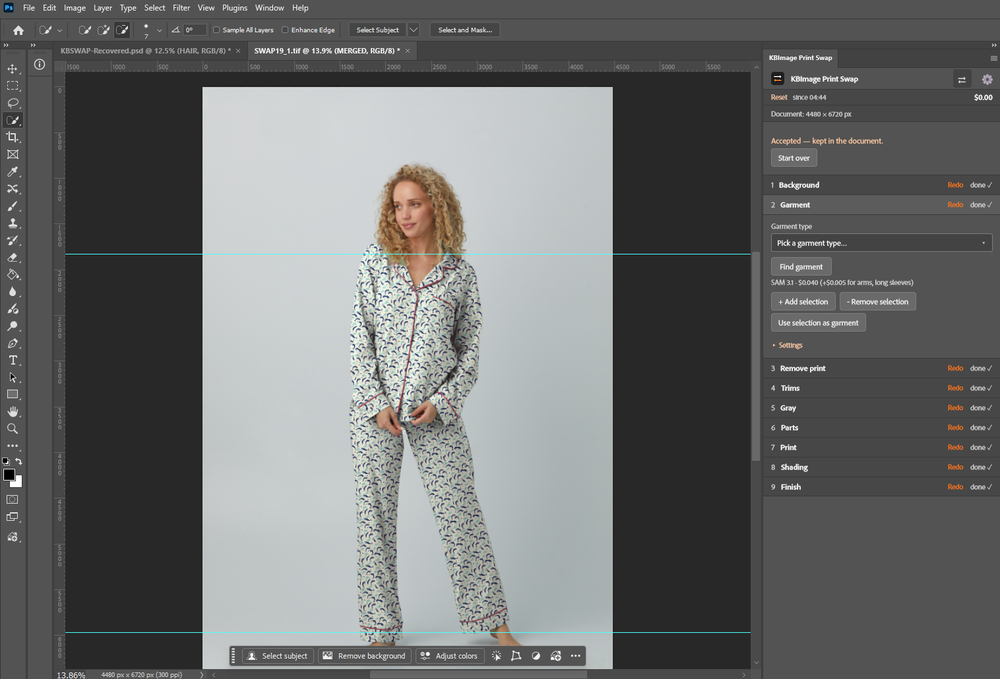
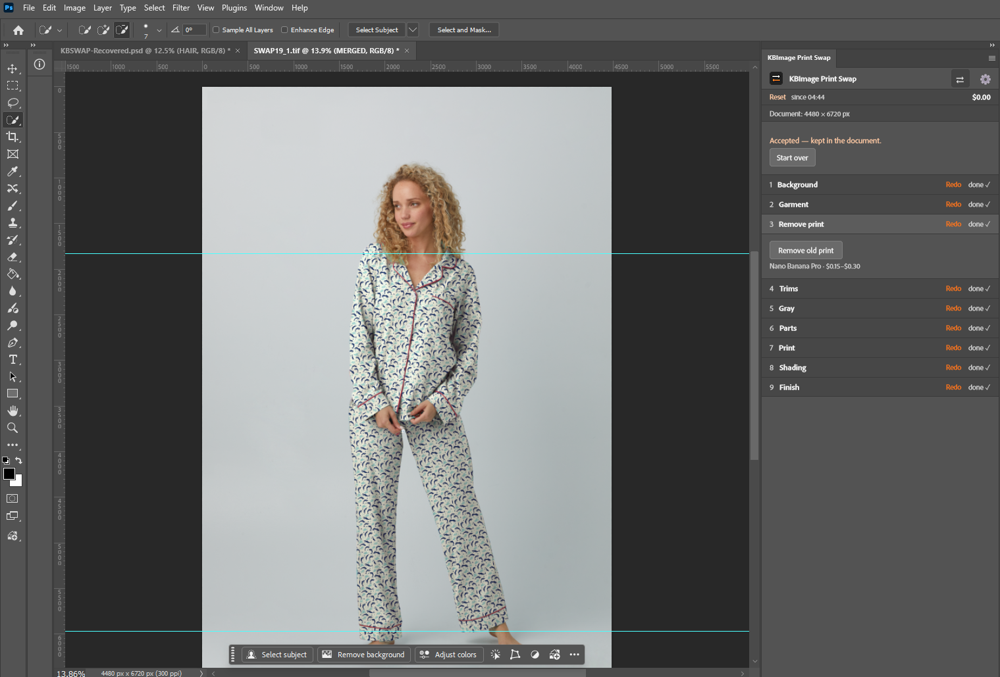
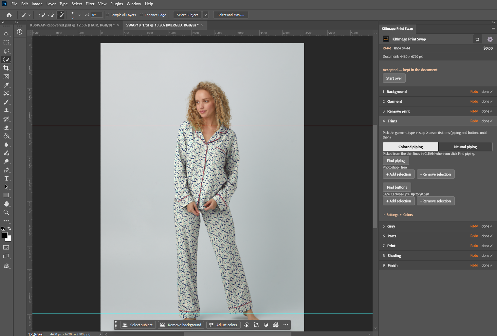
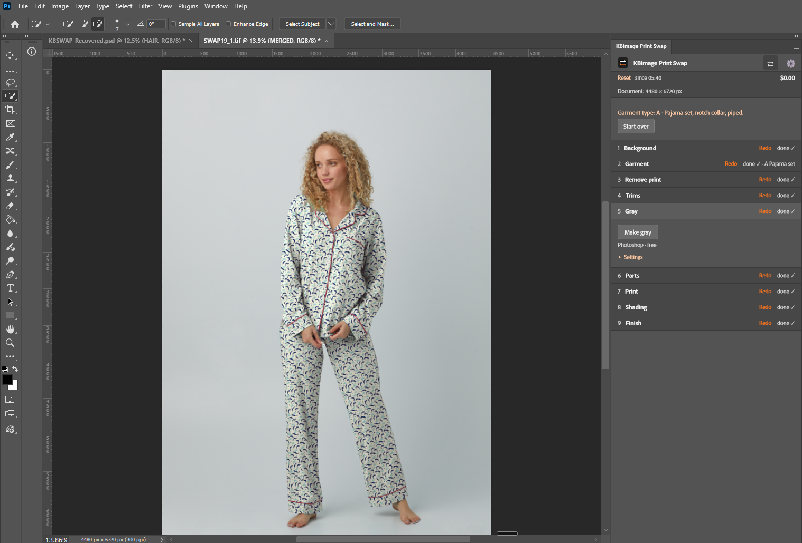
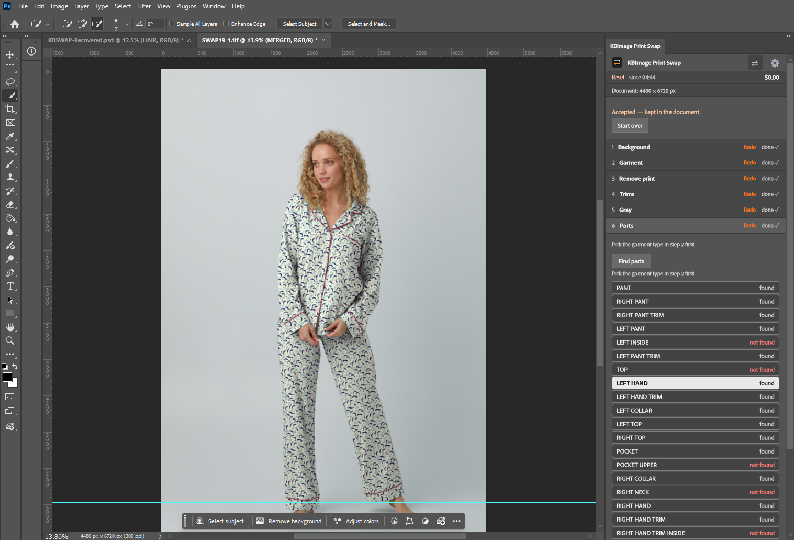

# KBImage Print Swap

A Photoshop panel that swaps the print on a garment photo for the retouching team. It builds the same layers, in the same order and with the same names, as the team's print swap file, and uses AI only where it saves time. Every step is checked and accepted by the retoucher before the next one runs.

**Version** 0.19.0 · **Plug-in id** `com.komar.kbimage.printswap` · **Photoshop** 2022 (23.3) or newer · **Tested on** Photoshop 2025 (v26) and Photoshop 2026 (v27)

## Install (UXP Developer Tool)

1. Install the **UXP Developer Tool** from the Creative Cloud desktop app (All apps).
2. In Photoshop, turn on Developer Mode: **Edit > Preferences > Plugins** (Mac: **Photoshop > Settings > Plugins**), tick **Enable Developer Mode**, then restart Photoshop.
3. With Photoshop open, open the UXP Developer Tool and click **Add Plugin**. Choose `manifest.json` in this folder.
4. On the plug-in's row click **•••** > **Load**.
5. In Photoshop open **Plugins > KBImage Print Swap**.

**After an update:** **•••** > **Remove**, then **Add Plugin** and **Load** again. Reload does not always pick up changes.
**After Photoshop restarts:** open the UXP Developer Tool and click **Load** again.
**For retouchers:** the plug-in can be packaged as a `.ccx` file (**•••** > **Package**) and installed by IT, with no Developer Mode needed.

## Quick start

1. Install the panel (above).
2. In Photoshop open **Plugins > KBImage Print Swap**.
3. Click the gear, paste the **Fal API key**, click **Save**.
4. Open the garment photo and work through steps 1 to 9, clicking **Accept** after each.

## The 9 steps

Background · Garment · Remove print · Trims · Gray · Parts · Print · Shading · Finish

| Step | Screenshot |
|---|---|
| 1 Background |  |
| 2 Garment |  |
| 3 Remove print |  |
| 4 Trims |  |
| 5 Gray |  |
| 6 Parts |  |
| 9 Finish: Layers panel |  |

Screenshots of steps 7 (Print) and 8 (Shading) are still to come; the full walkthrough is in the [user guide](docs/user-guide.md).

## AI used (all through one Fal key)

| Model | Used for | Cost |
|---|---|---|
| SAM 3.1 | Finding the garment, hands, trims and parts | $0.005 per request |
| Nano Banana Pro | Removing the old print (step 3) | $0.15 per image ($0.30 at 4K) |

A full run on a 4480 × 6720 photo costs about $0.35 to $0.55. Everything else is plain Photoshop.

## Documents

| Document | For |
|---|---|
| [User guide](docs/user-guide.md) | Retouchers: install, every step, every button, troubleshooting |
| [Rules and best practices](docs/print-swap-guide.md) | Retouchers: inputs, rules, what to check |
| [Garment types and part names](docs/parts-list.md) | Types A to H, parts and protected trims |
| [Design doc](docs/design-doc.md) | Review and approval: why, how, scope, risks |
| [CLAUDE.md](CLAUDE.md) | Developers: build rules |

## Files

`manifest.json` · `index.html` · `src/app.js` · `icons/` · `docs/`
