# KBImage Print Swap v0.20.14

Retoucher's guide · the 10 steps, the layers it builds, and how to fix a mask · Komar Brands, Creative Technology · October 2026

[How it works](#how-it-works) · [The 10 steps](#the-10-steps) · [Garment types](#garment-types) · [Layers](#the-layers-it-builds) · [Fixing masks](#fixing-a-mask) · [Install & support](#requirements-install-and-support)

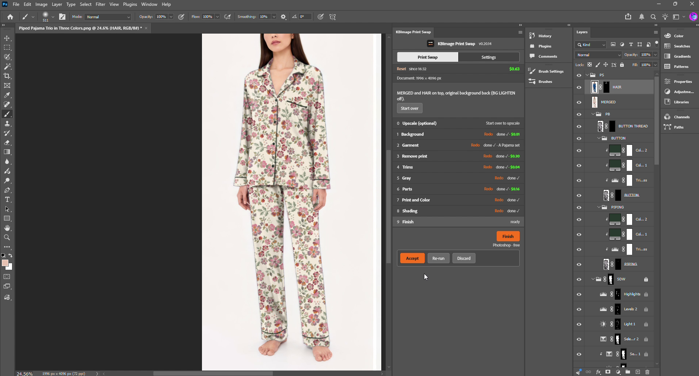
*A pajama set photographed in navy, re-printed in a floral with burgundy piping, by the plug-in alone.*

**A print swap that took a retoucher 2½ hours or more by hand takes 30 minutes or less with the panel.**

## How it works

Print Swap is a Photoshop panel. It takes a garment photo and puts a different print on it, keeping the model, the folds, the trims and the lighting. The work is split into ten steps. Each step builds one or two named layers or channels, shows you a preview, and keeps nothing until you click **Accept**. Done by hand, a swap averages 2½ hours or more; with the panel it is 30 minutes or less, most of it checking previews.

| Step | What it does | Builds | Cost |
|---|---|---|---|
| 0 Upscale | Enlarges a small photo with Topaz (optional). | UPSCALE layer | $0.08 |
| 1 Background | Finds the model (SAM) and builds a white or lightened backdrop. | BG LIGHTEN / MODEL + WHITE, KBPS person, KBPS hair | $0.005–0.010 |
| 2 Garment | Finds the garment, leaves out the hands. | KBPS garment channel | $0.03–0.05 |
| 3 Remove print | Nano Banana Pro paints the garment plain, folds kept. | CLEAN layer | $0.15–0.30 |
| 4 Trims | Finds piping and buttons; builds them as opaque groups. | PB › PIPING, BUTTON, BUTTON THREAD | free–$0.02 |
| 5 Gray | Neutral grey garment with its folds and the photo's sheen. | GREY exact layer | free |
| 6 Parts | Splits the garment into sleeves, collar, pocket… | PARTS › one group per part | $0.045–0.285 |
| 7 Print and Color | Tiles the print into each part; colors the trims. | PRINT in every part, trim Color Fills | free |
| 8 Shading | Lays the folds and shadows back over the print. | SDW group | free |
| 9 Finish | Stamps everything into one layer, adds the hair. | MERGED, HAIR | free |

A typical full style costs about **$0.30–$0.60**. The tally at the top of the panel shows the running total in green. Accept, Re-run and Discard sit under every step's button; Re-run charges again, Discard keeps any AI charge already made. **Redo** on a finished step clears that step and every step after it.

## The 10 steps

### Step 0 · Upscale (optional)

**Topaz on Fal · $0.08**

The panel shows the photo's long edge. Under 3000 px, upscale. The photo goes to Topaz at 2× (4× when very small) and comes back as an **UPSCALE** layer; the document is resized to 4000–6000 px and the original stays hidden under it. From here on UPSCALE is the photo.

* Discard puts the original back at its original size.
* Start over keeps UPSCALE, so you don't pay for it twice.
* A blurry result means the source was too small to rescue: ask for the original file.

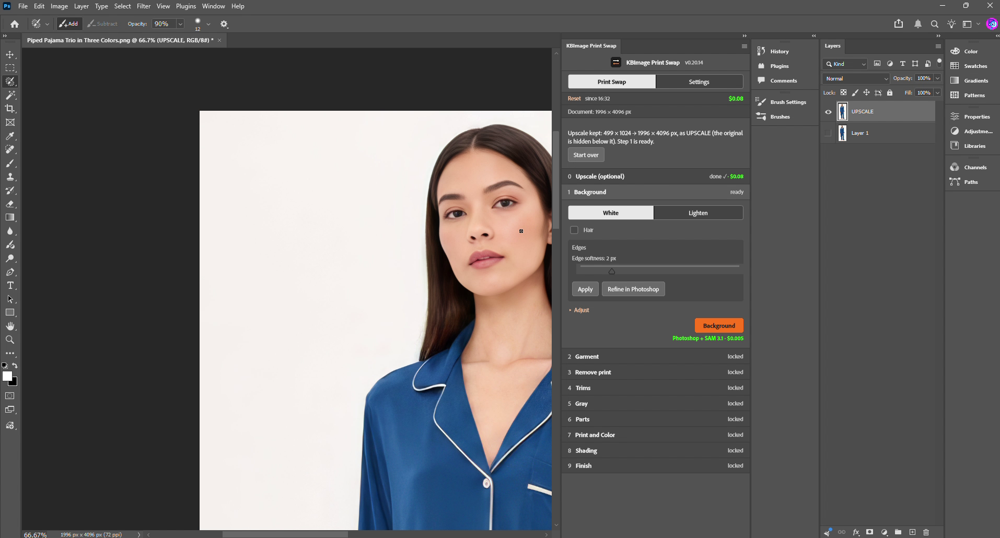

### Step 1 · Background

**SAM 3.1 · $0.005, $0.010 with Hair**

Pick **White** (the team's final look) or **Lighten**. Tick **Hair** when hair falls over the garment. SAM finds the model and saves it as **KBPS person**; the backdrop is built around that. White builds WHITE + MODEL; Lighten builds BG LIGHTEN (white at the Lighten opacity, masked to the inverse of the person), which Finish hides again.

* Edges › Edge softness (default 2 px) feathers the person edge. Click Apply after moving it.
* Photoshop's Select Subject and the automatic Select and Mask are switched off in this build: they crashed the GPU on the test machine. SAM does the work instead.

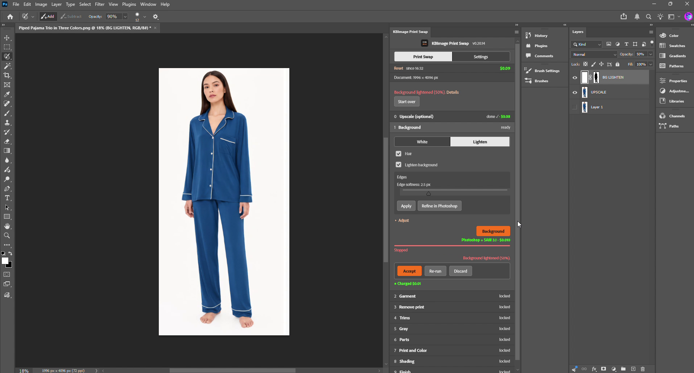

### Step 2 · Garment

**SAM 3.1 · $0.03–$0.05**

Pick the **Garment type** (A–H, or Other to build your own part list), then **Find garment**. SAM finds the garment and leaves out the hands and arms. The result is the **KBPS garment** channel, which every later step cuts to. 'Grow into old-garment fringe' (Adjust) pushes the edge out a few pixels into any fringe the old print left.

* **A** · Pajama set, notch collar, piped (the team's standard)
* **B** · Nightgown, long sleeve, yoke and placket
* **C** · Nightgown, long sleeve, ruffle neck and hem
* **D** · Nightgown, sleeveless, square neck
* **E** · Footed sleeper / zip coverall
* **F** · Knit top and short or pant, striped
* **G** · Tee and boxer short
* **H** · Sleeveless ruffle top and pant set
* **Other** · builds a new type (see Garment types)
* Fix the outline with Lasso, then + Add / − Remove / Use selection as garment (see Fixing masks).
* Edge softness 3 px is a good start on a 2000 × 4000 file; 4–5 px blends more on bigger files.

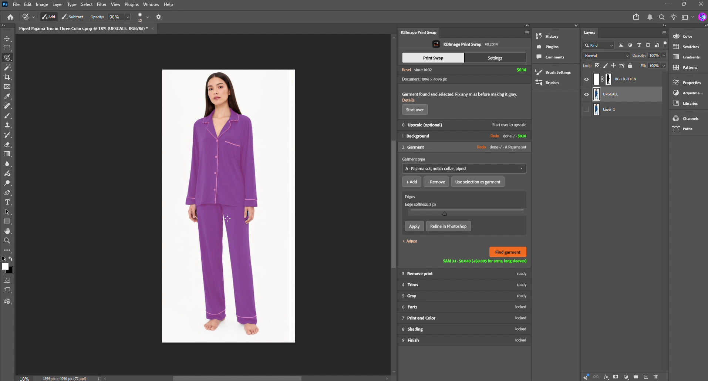

### Step 3 · Remove print

**Nano Banana Pro · $0.15, $0.30 at 4K**

**Remove old print** sends the garment to Nano Banana Pro with a prompt to paint it plain light grey, keeping folds, seams and trims. The answer comes back as the **CLEAN** layer. Everything in steps 4–8 reads CLEAN, not the photo, so check it closely at 100%.

* If the shape moved or a trim was redrawn, Re-run once.
* Edge bleed (Settings) is how far CLEAN reaches past the garment edge; the mask still sets the visible edge.

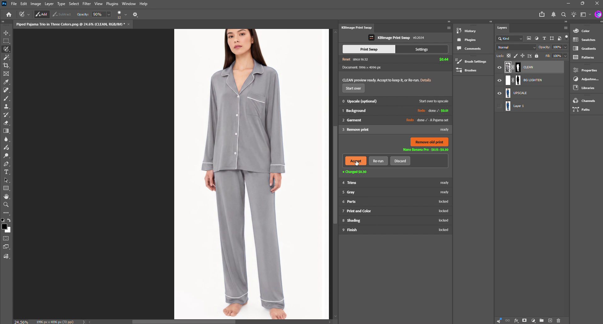

### Step 4 · Trims

**Find piping free · buttons and other trims SAM, about $0.005–$0.02 each**

**Find piping** (Colored, or Neutral for white/grey cord with a Light/Dark pick) finds the piping lines; **Find buttons** uses SAM close-ups. Each is saved as a channel (KBPS piping, KBPS buttons) and built as a group in **PB**: a copy of CLEAN masked to the channel at 100%, Normal, no Blend If, so the cord reads as opaque fabric. BUTTON THREAD is the same copy masked to the thread at 50%.

* Use selection as piping / buttons replaces the shape with your Lasso selection; + Add and − Remove adjust it.
* Piping opacity % (Adjust) fades the whole PIPING group. Button fit: Tight / Normal / Loose.

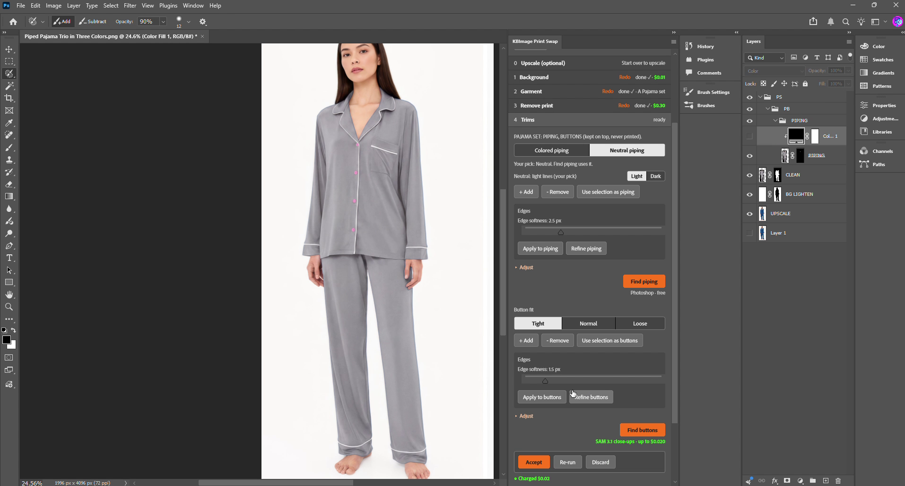

### Step 5 · Gray

**Photoshop · free**

**Make gray** reads CLEAN inside the garment, finds its median brightness and shifts every pixel so the median lands on the target (Light, Mid #BABABA, Dark or Custom). Folds are kept. The result is **GREY exact**, which drives the shading in step 8. **Highlights from photo %** (default 60) reads the original photo and puts its satin sheen back: broad highlights on shoulders and sleeve tops are lifted, sharp old-print edges are left out.

* Change the target or the % after Accept and click Update gray; no need to Redo.
* If the old print shows through, go back to step 3.

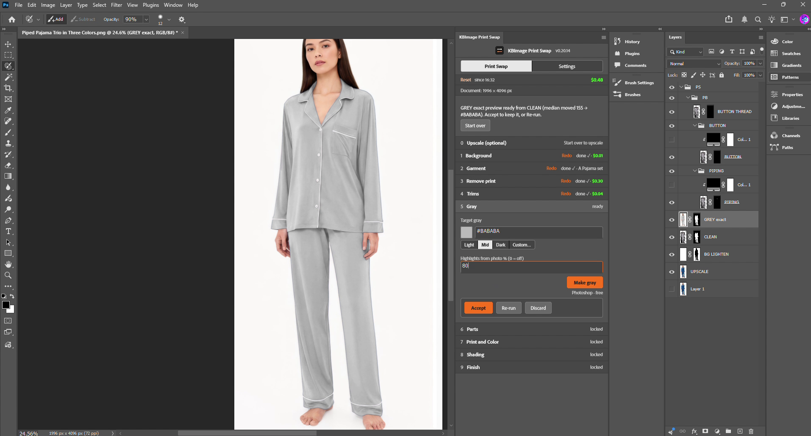

### Step 6 · Parts

**SAM 3.1 · $0.045–$0.285 per run**

Untick the parts this garment doesn't have, then **Find parts**. SAM finds each part; gaps are filled by the nearest part so every garment pixel belongs to exactly one. Each part becomes a channel (KBPS part NAME) and a group under **PARTS** holding '*NAME* shape' and, after step 7, PRINT clipped to it.

* Click a part in the list: its shape loads as the live selection. Grow or trim it with Lasso or Quick Selection in Add/Subtract mode, then + Add, − Remove or Use selection as part.
* Click the highlighted part again to deselect it. Hand fixes are free; Find parts again costs again.
* 'In this style, not in this photo' lists parts of the garment type that weren't found; + Add puts one back by hand.

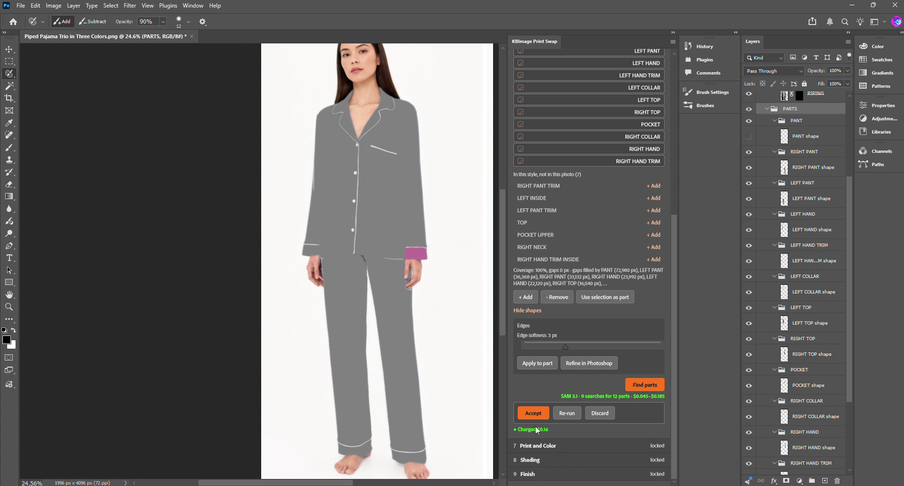

### Step 7 · Print and Color

**Photoshop · free**

**Swap print** loads a PNG/JPG/TIF; **Apply print** tiles it into every part at the chosen scale (% of the file's pixels) and angle (the part's long axis, plus whole-garment and per-part turns). **Continuous** runs one fabric across the seams. Each PRINT layer is clipped to its part's shape layer, Normal 100%. Below the print controls, **Trim colors** sets PIPING and BUTTON: **Original** (the cord as CLEAN made it) or **Custom…** (Photoshop's picker), or type a hex and press Enter. **Buttons same as piping** links them.

* The trim colors work as soon as step 4 is accepted; you don't need to apply the print first.
* Swapping the print keeps the trim colors. The 2 newest prints are kept in the Backup group for comparison.

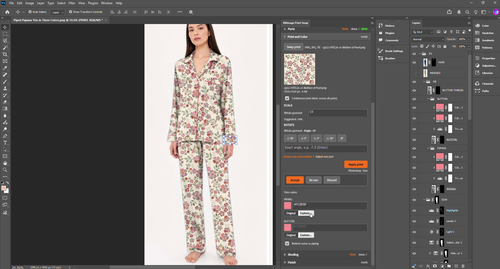

### Step 8 · Shading

**Photoshop · free**

**Build shading** makes the **SDW** group: GREY exact turned into a shadow map and laid over the print in Multiply, so flat fabric stays white (no change) and only folds darken. Pick Light/Dark for garment and print; the defaults follow from the measured lightness. The adjustment layers inside SDW are listed on the next page.

* Too flat: raise Shading strength or Fold contrast. Too heavy: lower Burn %. Dull: raise Highlights %.
* Light 1, Levels 2 and Highlights have paintable masks: paint white to add a fold, black to remove one. Build shading again replaces them.

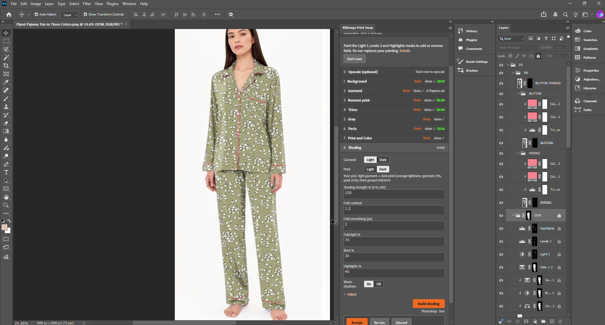

### Step 9 · Finish

**Photoshop · free**

**Finish** hides BG LIGHTEN and the Backup group, confirms PB and SDW are visible, repairs any PRINT that lost its clipping, and stamps everything visible into **MERGED** at the top of PS. With Hair ticked it adds **HAIR** above MERGED from KBPS hair. Check at 100%, Accept, save the PSD.

* MERGED is a flat copy: the groups under it are untouched, so you can change a trim color or the shading and Finish again.
* If MERGED is missing something, read the status line and send printswap-trace.txt (see Support).

## Garment types

Step 2 asks for the garment type. It decides which parts step 6 looks for, how they are split left/right and top/bottom, and which trims step 4 offers. Eight types ship in this build. Pick the closest one; untick parts the photo doesn't show.

| Type | Garment | Parts it looks for | Trims |
|---|---|---|---|
| A | Pajama set, notch collar, piped (the team's standard) | PANT, LEFT/RIGHT PANT, PANT TRIMs, LEFT INSIDE, TOP, LEFT/RIGHT HAND, HAND TRIMs, LEFT/RIGHT COLLAR, LEFT/RIGHT TOP, POCKET, POCKET UPPER, RIGHT NECK, RIGHT HAND TRIM INSIDE | Piping, buttons |
| B | Nightgown, long sleeve, yoke and placket | FRONT/BACK YOKE, GOWN FRONT/BACK, PLACKET, NECK BAND, LEFT/RIGHT HAND, HAND TRIMs, LEFT/RIGHT COLLAR, GOWN INSIDE | Buttons, lace |
| C | Nightgown, long sleeve, ruffle neck and hem | GOWN FRONT/BACK, NECK RUFFLE, HEM RUFFLE, LEFT/RIGHT HAND, HAND RUFFLEs, HAND TRIMs | Ruffle lace |
| D | Nightgown, sleeveless, square neck | FRONT/BACK YOKE, GOWN FRONT/BACK, LEFT/RIGHT STRAP, LEFT/RIGHT ARMHOLE, GOWN INSIDE | Lace, buttons |
| E | Footed sleeper / zip coverall | LEFT/RIGHT FRONT, LEFT/RIGHT HAND, HAND TRIMs, LEFT/RIGHT LEG, LEFT/RIGHT FOOT, NECK BAND | Zipper |
| F | Knit top and short or pant, striped | TOP FRONT, PLACKET, NECK BAND, LEFT/RIGHT HAND, HAND TRIMs, LEFT/RIGHT SHORT or PANT, WAISTBAND, SHORT TRIMs | Buttons, drawcord |
| G | Tee and boxer short | TOP FRONT, CHEST POCKET, NECK BAND, LEFT/RIGHT HAND, LEFT/RIGHT SHORT, WAISTBAND | Drawcord |
| H | Sleeveless ruffle top and pant set | TOP FRONT, NECK RUFFLE, LEFT/RIGHT ARMHOLE, LEFT/RIGHT PANT, WAISTBAND | Bow |

### Adding a type, or fine-tuning one

Pick **Other** in the step 2 dropdown and a builder opens: choose the trims and tick the parts from the full list (every part name A–H knows, plus the generic ones: sleeve, cuff, collar, yoke, placket, neck band, strap, armhole, zipper, leg, foot, waistband, pocket, ruffles). The type is stored in the document, so the file carries it. **Save as type** gives it the next letter (I, J…) and writes it to `print-swap-custom-types.json` next to the parts list, where every machine that shares the folder picks it up. A–H never change.

* A part is found by a SAM query (the words it searches for), a side (left or right of the centre line), a region (top piece, bottom piece, or one-piece), and a priority: when two parts claim the same pixel, the lower number wins. 'Rest' parts take whatever is left in their region.
* To tune a type that keeps missing a part, the fix is usually the query words or the priority, both in the saved JSON. Send the trace from a run and the part name; the change is a one-line edit.
* Two parts with the same query and side (FRONT YOKE and BACK YOKE) are given to the first one checked: untick the one that isn't in view.

## The layers it builds

Everything lives in one group, **PS**, so a file can be handed on with the plug-in's work in one place. Bottom to top:

| Where | Layer | What it is | Touch it? |
|---|---|---|---|
| Document | Layer 1 / UPSCALE | The original photo; UPSCALE is the Topaz enlargement, the original hidden under it. | No |
| Document | BG LIGHTEN, or WHITE + MODEL | The backdrop from step 1. BG LIGHTEN is white at the Lighten opacity, masked to the inverse of the person; Finish hides it. | Opacity only |
| Document | CLEAN | Nano Banana Pro's plain garment (step 3). Trims and the gray are cut from it. | No |
| Document | GREY exact | The neutral grey garment with folds and sheen (step 5); hidden once shading is built. | No |
| PS › PARTS | NAME shape + PRINT | One group per part. The shape layer is the part cut from CLEAN; PRINT is the tiled print clipped to it. | Via the panel |
| PS › SDW | SHADOW (+ SHADOW 2) | GREY exact cut to the garment, median → white, desaturated, Multiply at Shading strength. Above 100% a second copy carries the rest. | Opacity |
| PS › SDW | Color Balance 1 (clipped) | Warm shadows: midtones pushed toward the print's ground color so shadows don't go grey. | Yes |
| PS › SDW | Brightness/Contrast 1 (clipped) | Fold contrast: 1.0 = no change, 2.0 = contrast 50. | Yes |
| PS › SDW | Selective Color 1 / 2 | Fine color of the shadow (clipped) and of the garment (masked to KBPS garment). Built neutral for you to tune. | Yes |
| PS › SDW | Light 1 | Fold light %: a Brightness/Contrast on the fold edges only (mask = where the grey changes fastest). | Paint the mask |
| PS › SDW | Levels 2 | Burn %: darkens the deepest folds only (mask = the darkest few % of the garment). | Paint the mask |
| PS › SDW | Highlights | Highlights %: Levels on Screen, masked to the lit side of the folds. | Paint the mask |
| PS › PB | PIPING, BUTTON | CLEAN masked to the trim channel, Normal 100%. Inside: Trim lightness (Levels), Color Fill 1 (Color mode, the hue) and Color Fill 2 (Multiply 35%, body). | Color via the panel |
| PS › PB | BUTTON THREAD | CLEAN masked to the thread, 50%. | Opacity |
| PS | Backup | The previous print, hidden. Finish never stamps it. | No |
| PS | MERGED, HAIR | The stamped result and the hair over it (step 9). | Deliverable |

### The Layers panel after Finish

HAIR and MERGED on top, then PB with BUTTON THREAD, BUTTON and PIPING (each trim group holding its Color Fills and Trim lightness), then SDW with Highlights, Levels 2, Light 1 and the Selective Color layers, then PARTS. The lock icons on SDW mean the panel owns those layers: Build shading replaces them.

**Every shape the panel uses is also a channel.** Open the Channels panel and you'll see **KBPS person, KBPS hair, KBPS garment, KBPS piping, KBPS buttons** and one **KBPS part NAME** per part, each with a hard 'raw' copy. The channel is the master; the layer masks are rebuilt from it. That is why a brush stroke on a layer mask disappears at the next rebuild, and why the fix always goes through the panel's buttons.

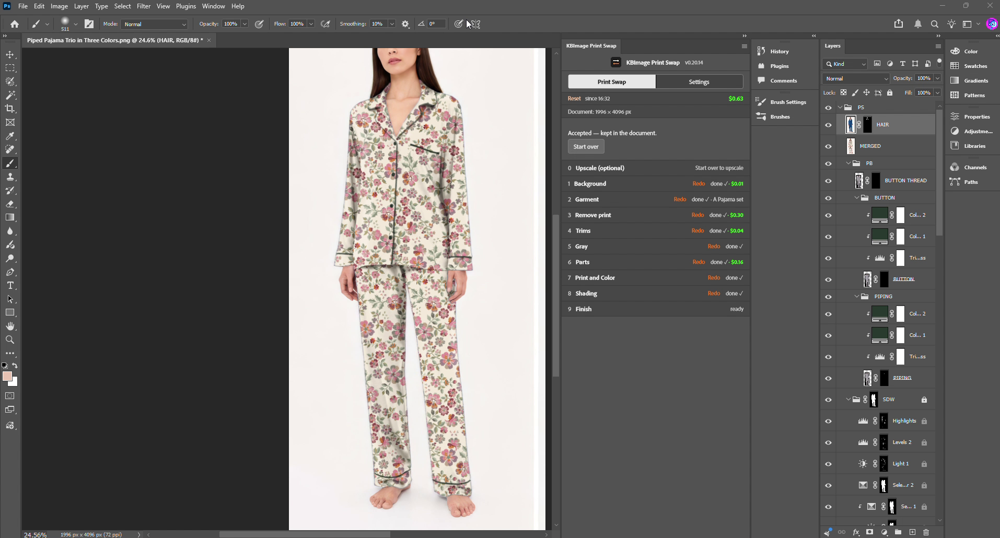

## Fixing a mask

The same three buttons appear wherever there is a shape: garment (step 2), piping and buttons (step 4), parts (step 6).

* **Select** the area with Lasso, Quick Selection or any selection tool. In step 6, click the part first so its shape loads as the selection and Add/Subtract mode grows or trims it directly.
* **+ Add** adds the selection to the shape. **− Remove** takes it out. **Use selection as …** replaces the shape with the selection.
* The shape is re-softened at the step's Edge softness and the layer rebuilt. Hand fixes cost nothing.
* **Edges › Apply** re-feathers from the hard copy, so you can change softness as often as you like without losing detail. **Refine in Photoshop** opens Select and Mask on the shape: click OK there and the result comes back.
* A new Find on the same step replaces the shape and your fixes: the panel asks you to click again within 5 seconds to confirm.

### What doesn't stick

Painting a layer mask with the brush. Dragging a layer. Renaming or moving the PS groups. Changing a PRINT layer's blend mode. Each of these is undone by the next rebuild (a touch-up, Edges, a new print, Finish). If you want a change that stays, make it on MERGED after Finish, or make it with the panel's buttons.

### Workflow tips

* Run the ten steps in order on a fresh copy of the photo. Save after each Accept; a crash loses what isn't on disk.
* Check every AI result at 100% before Accept. Re-run costs; Discard doesn't give the charge back.
* Set Edge softness before Finish, not after: MERGED is a flat copy.
* To try another print, Swap print in step 7, then Build shading and Finish again. The previous print waits in Backup.
* To change a trim color after Finish: pick it in step 7, then Finish again.

## Requirements, install and support

### Requirements

* Photoshop 23.3 or newer; tested on Photoshop 2026 (v27), Windows.
* A Fal API key in the panel's Settings tab (admin PIN locks it).
* Internet access to fal.run, fal.ai, fal.media and storage.googleapis.com, including subdomains.
* The garment photo as TIFF or PSD, 8-bit RGB, 4000 px or more on the long edge after Upscale; the print file at full resolution.

### Install

* Close Photoshop. Double-click **KBImage-PrintSwap-v0.20.14.ccx**; Creative Cloud installs it. Confirm the unverified-developer warning.
* Open Photoshop › Plugins › KBImage Print Swap. Dock the panel on the right, about 360 px wide. The version shows in the panel title.
* Settings: paste the Fal key, set a PIN, Test Connection, Save.
* Developers: UXP Developer Tool › Add Plugin › manifest.json › Load. After a code change, Remove and Add again.

### Known limits in this version

* Select Subject and the automatic Select and Mask are off (they crashed the GPU on the test laptop). SAM 3.1 finds the person and hair instead.
* Hand-painted layer masks are not kept. Use the panel's buttons.
* 16-bit files and files over 6000 px are slow. Convert to 8-bit first.
* Versions 0.20.11–0.20.14 were tested on one machine. Treat this as a beta.

### Reporting a problem

Send three things: the version from the panel title, a screenshot of the panel and canvas, and the log file **printswap-trace.txt** from the plug-in's data folder (`%APPDATA%\Adobe\UXP\PluginsStorage\PHSP\27\External\com.komar.kbimage.printswap\PluginData`, or `Developer` instead of `External` when loaded through the Developer Tool). Copy the log before running the plug-in again; each run overwrites it. The session .jsonl files in the same folder record every step and its cost.
